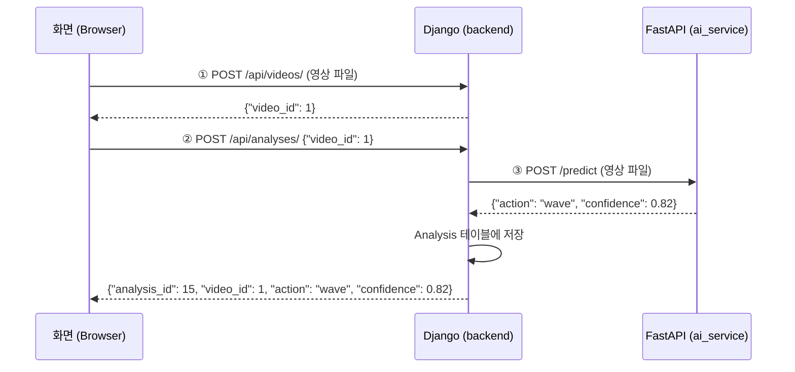

# Vision AI API 명세서

> 영상 업로드 → AI 동작 분석 → 결과 저장/표시 흐름의 API 약속 문서입니다.
> 코드와 다르게 바뀌면 이 문서를 먼저 고치고 팀에 공유합니다.

| 항목 | 내용 |
|---|---|
| 최종 수정 | 2026-11-25 |
| 상태 표기 | ✅ 구현 완료 · 🚧 구현 중 · 📝 설계만 |

---

## 1. 전체 흐름



| 화면 요소 | 호출 API |
|---|---|
| 파일선택 / 드래그 앤 드롭 | 없음 (브라우저에서 처리) |
| 동영상 나오는 곳 (미리보기) | 없음 (`URL.createObjectURL()`) |
| 동영상 AI 분석 버튼 | ① 업로드 → ② 분석 요청 순서로 호출 |
| 결과 영역 (예측 동작, 확신도) | ②의 응답으로 표시 |

---

## 2. 공통 규칙

| 항목 | 내용 |
|---|---|
| Django 주소 | `http://localhost:8000` |
| FastAPI 주소 | `http://localhost:8001` |
| 데이터 형식 | JSON (파일 업로드만 `multipart/form-data`) |
| URL 끝 슬래시 | Django API는 끝에 `/` 를 붙인다 (`/api/videos/`) |
| 에러 응답 형식 | `{"detail": "에러 메시지"}` (Django·FastAPI 공통) |

---

## 3. API 목록

| # | 이름 | Method | URL | 서버 | 담당 | 상태 |
|---|---|---|---|---|---|---|
| 1 | 영상 업로드 | POST | `/api/videos/` | Django | 백엔드 A | ✅ |
| 2 | 분석 요청 | POST | `/api/analyses/` | Django | 백엔드 B | ✅ |
| 3 | 동작 예측 (내부용) | POST | `/predict` | FastAPI | AI 서비스 | 📝 |
| 4 | 서버 상태 확인 | GET | `/health` | FastAPI | AI 서비스 | 📝 |

---

### 3-1. 영상 업로드 ✅

`POST /api/videos/` · Django · `backend/videos/views.py`

**요청** — `multipart/form-data`

| 필드 | 타입 | 필수 | 설명 |
|---|---|---|---|
| `file` | File | O | 동영상 파일 |

**응답**

| 상태 코드 | 상황 | 본문 |
|---|---|---|
| 201 | 저장 성공 | `{"video_id": 1}` |
| 400 | 파일 없음 | `{"detail": "file is required"}` |

```bash
curl -X POST http://localhost:8000/api/videos/ -F "file=@walk_01.mp4"
```

---

### 3-2. 분석 요청 ✅

`POST /api/analyses/` · Django · `backend/analyses/views.py`

업로드된 영상을 FastAPI(3-3)로 보내 예측하고, 결과를 `Analysis` 테이블에 저장한 뒤 돌려준다.

**요청** — `application/json`

```json
{ "video_id": 1 }
```

| 필드 | 타입 | 필수 | 설명 |
|---|---|---|---|
| `video_id` | int | O | 3-1에서 받은 영상 ID |

**응답**

| 상태 코드 | 상황 | 본문 |
|---|---|---|
| 201 | 분석·저장 성공 | 아래 JSON |
| 400 | `video_id` 없음 | `{"detail": "video_id is required"}` |
| 404 | 해당 영상 없음 | `{"detail": "video not found"}` |
| 502 | FastAPI 호출 실패 | `{"detail": "AI service error"}` |

성공 응답 (201)

```json
{
  "analysis_id": 15,
  "video_id": 1,
  "action": "wave",
  "confidence": 0.82
}
```

| 응답 필드 | 타입 | 설명 | DB 칸 |
|---|---|---|---|
| `analysis_id` | int | 저장된 분석 결과 ID (최근분석이력·상세 조회용) | `id` |
| `video_id` | int | 분석한 영상 ID | `video_id` |
| `action` | string | 예측 동작 (5장 클래스 목록 중 하나) | `predicted_action` |
| `confidence` | float | 확신도 0~1 (화면에는 82%처럼 표시) | `confidence` |

```bash
curl -X POST http://localhost:8000/api/analyses/ \
     -H "Content-Type: application/json" \
     -d '{"video_id": 1}'
```

---

### 3-3. 동작 예측 (내부용) 📝

`POST /predict` · FastAPI · `ai_service/main.py`

화면에서는 직접 호출하지 않는다. **Django(3-2)만 호출한다.**

처리 순서: 영상 Frame → YOLO Pose → 사람별 Feature → Sequence(30 step, 1,140차원) → Random Forest 예측

**요청** — `multipart/form-data`

| 필드 | 타입 | 필수 | 설명 |
|---|---|---|---|
| `file` | File | O | 동영상 파일 |

**응답**

| 상태 코드 | 상황 | 본문 |
|---|---|---|
| 200 | 예측 성공 | `{"action": "wave", "confidence": 0.82}` |
| 400 | 동영상이 아님 | `{"detail": "invalid video file"}` |
| 422 | 사람(포즈)을 찾지 못함 | `{"detail": "no person detected"}` |
| 503 | 모델이 로드되지 않음 | `{"detail": "model not loaded"}` |

---

### 3-4. 서버 상태 확인 📝

`GET /health` · FastAPI · `ai_service/main.py`

입력 없음. 서버가 켜져 있는지, 모델이 로드됐는지 확인한다. Django가 3-3을 호출하기 전 점검용으로도 쓸 수 있다.

**응답** — 200

```json
{ "status": "ok" }
```

---

## 4. DB 테이블

### Video — `videos` 앱 (백엔드 A)

| 칸 | 타입 | 설명 |
|---|---|---|
| `id` | int (PK) | 자동 증가 |
| `file` | FileField | `media/videos/` 에 저장 |
| `created_at` | DateTime | 업로드 시각 (자동) |

### Analysis — `analyses` 앱 (백엔드 B)

| 칸 | 타입 | 설명 |
|---|---|---|
| `id` | int (PK) | 자동 증가 |
| `video` | ForeignKey → `videos.Video` | 분석한 영상 (영상 1개 : 분석 N개, 영상 삭제 시 함께 삭제) |
| `predicted_action` | CharField(50) | 예측 동작 |
| `confidence` | Float | 확신도 0~1 |
| `created_at` | DateTime | 분석 시각 (자동) |

DB: 개발 중에는 SQLite(`backend/db.sqlite3`), 이후 PostgreSQL로 전환 예정 (백엔드 A).

---

## 5. 동작 클래스 목록

`from_b4/rf_training_info.json` 기준 6개. `action` 값은 아래 중 하나다.

| `action` 값 | 동작 |
|---|---|
| `bend_return` | 숙였다 돌아오기 |
| `drink_return` | 마시는 동작 후 돌아오기 |
| `leg_raise_lower` | 다리 들었다 내리기 |
| `sit_stand` | 앉았다 일어서기 |
| `walk_turn_walk` | 걷다 돌아서 걷기 |
| `wave` | 손 흔들기 |

---

## 6. 폴더·앱 이름

```
vision_ai/
├── backend/            # Django
│   ├── config/         # 프로젝트 설정 (settings.py, urls.py)
│   ├── videos/         # 영상 업로드 (백엔드 A)
│   └── analyses/       # AI 분석 요청·저장 (백엔드 B)
├── ai_service/         # FastAPI (AI 추론)
├── from_b4/            # 학습 정보 (Feature 컬럼, 학습 설정)
└── docs/
    └── API.md          # 이 문서
```

합칠 때 충돌이 잘 나는 곳: `config/settings.py` 의 `INSTALLED_APPS`, `config/urls.py`, `requirements.txt` → 양쪽 줄을 모두 살린다.